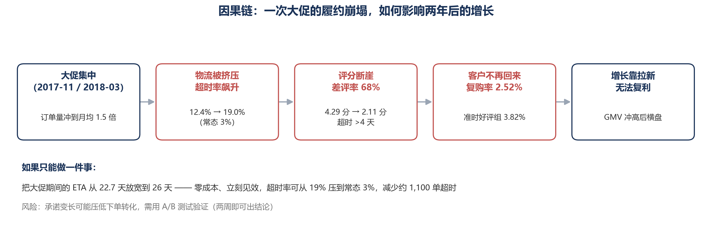
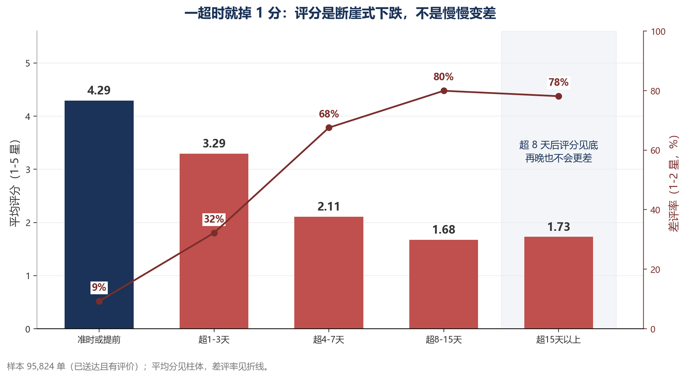
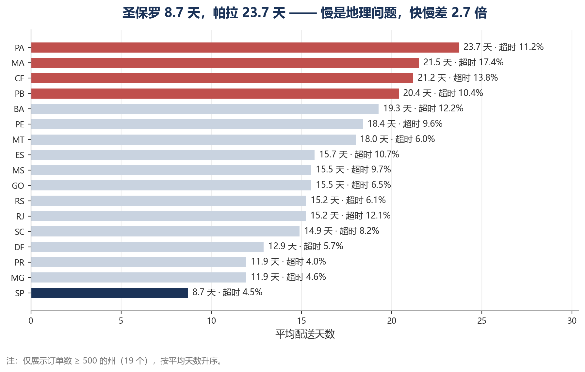
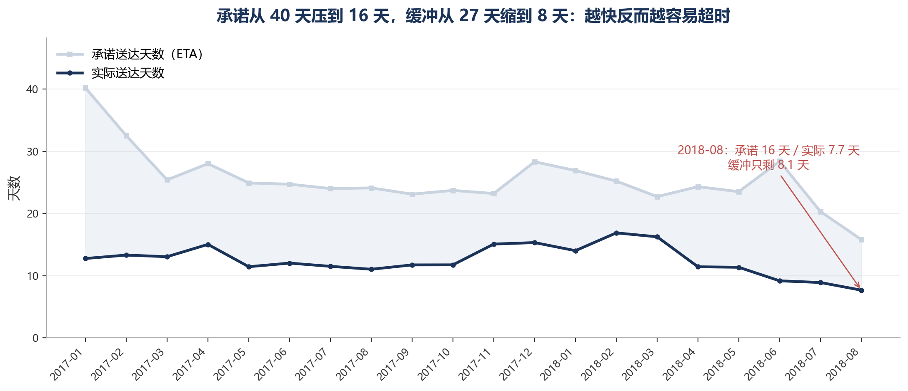
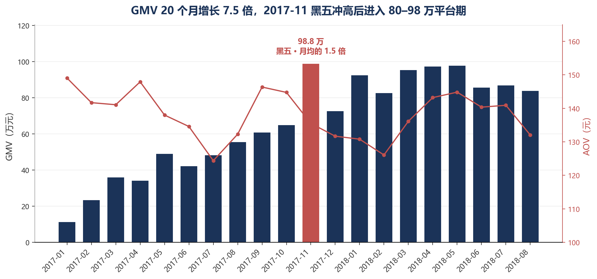

# Olist 巴西电商履约与增长分析

> 从 155 万行真实交易数据，看「超时 → 差评 → 不复购」如何拖住增长

**数据**：Brazilian E-Commerce Public Dataset by Olist（9 张表 / 155 万行 / 2016.09 – 2018.10）
**工具**：MySQL 8.0 · Python 3.14 · pandas · matplotlib
**产出**：5 个 SQL 脚本 · 10 个 Python 脚本 · 13 张图 · 5 章报告（约 1.2 万字）

---

## 一句话结论

**Olist 的增长瓶颈不在获客，在履约。**

大促把订单量推到月均的 1.5 倍，物流跟不上，用户给差评、不再回来；而平台本身的复购率只有 4–5%，补不上缺口——所以增长只能靠一波一波地拉新，形不成复利。



---

## 三个核心数字

| 数字 | 含义 |
|---|---|
| **6.7% → 32.5%** | 超时订单只占样本的 6.7%，却贡献了 32.5% 的差评。超时订单的差评率约 62%，准时订单只有 9.2%——差 6.7 倍 |
| **4.29 → 2.11** | 准时订单平均 4.29 分；超时 1–3 天掉到 3.29；超 4–7 天崩到 2.11。超 8 天后见底，再晚也不会更差 |
| **2.52% vs 3.82%** | 首单「超时 + 差评」的客户复购率 2.52%，准时好评组 3.82%（χ²=14.53, p<0.001） |

---

## 关键发现

### 1. 评分不是慢慢变差，是断崖式下跌

| 分箱 | 订单数 | 平均分 | 差评率 |
|---|---|---|---|
| 准时或提前 | 89,443 | **4.291** | 9.23% |
| 超 1–3 天 | 1,852 | **3.291** | **32.18%** |
| 超 4–7 天 | 1,748 | **2.106** | **67.56%** |
| 超 8–15 天 | 1,601 | 1.675 | 79.95% |
| 超 15 天以上 | 1,180 | 1.728 | 78.14% |

一超时就掉 1 分、差评率翻 3.5 倍；超 8 天后见底，再晚也不会更差。
**补救窗口只在超时后 1–3 天**——4 天以后补偿换不回评价。



### 2. 慢是地理问题，不是商品问题

SP（圣保罗）平均 8.70 天、超时率 4.49%；PA（帕拉）23.73 天——**快慢差 2.7 倍**。
而品类之间只有 10.87–13.66 天、超时率 5.00%–7.56%，几乎没有区分度。

这一条排除了「某些商品难配送」的解释，把问题锁定在地理上。



### 3. 超时率不是物流指标，是承诺管理指标

承诺天数从 40 天压到 16 天，实际从 12.8 天降到 7.7 天，**缓冲从 27 天缩到 8 天**——结果送得更快，反而更容易超时。

| 月份 | 实际天数 | 承诺天数 | 缓冲 | 超时率 |
|---|---|---|---|---|
| 2018-06 | 9.16 | 28.4 | 19.2 天 | **1.16%** |
| 2017-11 | 15.07 | 23.2 | 8.1 天 | 12.40% |
| 2018-08 | **7.66**（最快） | 15.8 | 8.1 天 | 6.19% |



### 4. 地域集中、品类分散

州 Top10 覆盖 **87.9%**（SP 一州占 38.4%），品类 Top10 只覆盖 **62.5%**（第一名仅 9.33%）。

> 地域是收敛的，资源按州配；品类是发散的，只能广撒试探。



---

## 三条建议

| 优先级 | 建议 | 效果 | 成本 |
|---|---|---|---|
| **1** | 大促期间 ETA 放宽 15%（22.7 → 26 天） | 减 1,100 单超时 / 590 个差评 | **零** |
| 2 | 按州设 SLA，取消全国统一承诺 | 减 2,190 单超时 / 1,160 个差评 | 低 |
| 3 | 超时预警前置到「超时前 1 天」 | 减 320 个差评 | 中 |

**如果只能做一件事**：做建议 1。零成本、当天生效、不依赖任何能力提升——它只是把「承诺」调到和「能力」匹配。

---

## 分析方法

### 先用「能力矩阵」选题，而不是先看数据

拿到数据后列出常见分析主题，逐条判断字段是否支撑：

| 分析主题 | 必需字段 | 是否具备 |
|---|---|---|
| 转化漏斗 | 浏览 / 加购 / 购买日志 | ✗ 只有成单 |
| 留存与复购 | 用户唯一标识 + 时间 | △ 复购率仅 4–5%，做不了主线 |
| **履约时效** | 四个时间戳（下单/交运/送达/承诺） | ✓✓ |
| **满意度归因** | 评分 + 履约字段 | ✓✓ |
| 毛利 / 广告效率 | 成本、曝光、点击 | ✗ |

结论：唯一「字段齐全、且能从头走到尾」的路径是 **履约时效 → 满意度 → 复购**。

### 双路对账：SQL 与 pandas 各算一遍

关键指标用两条独立路径各算一次，对不上就查清原因。全程触发 7 次不一致：

- 4 次是**引擎语义差异**（`DATEDIFF` 整天截断 vs 秒差；pandas `groupby` 默认丢 NaN 分组；`COUNT(*)` vs `COUNT(列)`）
- 2 次是**我方错误**（把物理行数当记录数；假设 `review_id` 唯一）
- 1 次是**口径分歧**

其中一条最能说明问题：明细与支付的金额对账，全量口径差 **1.04%**，按已送达口径重算只有 **0.02%**——
差额几乎全部来自非已送达订单。**对账之前先确认两边是不是同一批订单**，否则会把口径问题误判成数据错误。

细节见 [docs/reconciliation_log.md](docs/reconciliation_log.md)。报告每章末尾附核对数字，用于复跑比对。

### 主动反驳自己

从「超时 → 差评」最容易错的地方是：偏远州用户本来就更挑剔。于是按州拆开验证：

| 州 | 准时组 | 超时组 | 落差 |
|---|---|---|---|
| SP | 4.33 | 2.55 | −1.78 |
| RJ | 4.24 | 1.91 | −2.33 |
| PA | 4.15 | 1.92 | −2.23 |

每个州都掉 1.7–2.4 分，反驳不成立。

---

## 数据处理说明

9 张表逐一体检，处理了 7 类问题（全部实测）：

| 问题 | 规模 | 处理 |
|---|---|---|
| 物流日期为空字符串 | 2,980 行 | 先入字符串再转 NULL |
| `review_id` 重复 | 789 个 ID / 814 行 | 改用 `(review_id, order_id)` 复合主键 |
| 评论含换行符 | 3,852 条 | 只导评分等定长字段 |
| 品类缺失 | 610 个商品 | 归入「未标注」，图注说明 |
| 翻译表缺 2 个品类 | 13 个商品 | 按葡语意译补齐 |
| 有支付无明细 | 775 单 | 报告说明，不影响 GMV |
| `customers` 与订单同为 99,441 行 | — | 复购率必须用 `customer_unique_id` |

完整字段说明见 [docs/data_dictionary.md](docs/data_dictionary.md)。

---

## 目录结构

```
olist/
├── sql/
│   ├── 01_load_all.sql          建表 + 导入 + 校验（一键执行）
│   ├── 02_ch1_overview.sql      第 1 章 生意盘子
│   ├── 03_ch2_delivery.sql      第 2 章 履约质量
│   ├── 04_ch3_satisfaction.sql  第 3 章 时效与满意度
│   └── 05_ch4_repurchase.sql    第 4 章 复购验证
├── src/
│   ├── ch1_extract.py / ch1_charts.py
│   ├── ch2_extract.py / ch2_charts.py
│   ├── ch3_extract.py / ch3_charts.py
│   ├── ch4_extract.py / ch4_charts.py
│   ├── ch5_chart.py
│   └── build_report.py          生成报告 DOCX
├── report/
│   └── Olist项目报告.pdf            完整报告（13 页）
│   └── ch1 ~ ch5_*.md               分章底稿
├── docs/
│   ├── data_dictionary.md           字段字典
│   └── reconciliation_log.md        对账日志
└── output/
    ├── figs/*.png                   13 张图（提交）
    └── ch*_*.csv                    中间结果（不提交）
```

---

## 如何复现

### 1. 准备数据

从 [Kaggle](https://www.kaggle.com/datasets/olistbr/brazilian-ecommerce) 下载，解压到 `_data/olist/`，
并生成两个清洗后的文件（生成方式见第 2 章的数据处理说明）：

- `clean/reviews_clean.csv` — 99,224 行、5 列、无引号无换行
- `clean/translation_clean.csv` — 71 行、去 BOM 与回车

### 2. 建库导入

```sql
-- MySQL Workbench，先设置连接参数 OPT_LOCAL_INFILE=1 并重连
source sql/01_load_all.sql
```

脚本末尾带 6 组校验：8 张表行数、空日期、评分分布、品类名回车、JOIN 匹配、时间范围。

### 3. 跑分析

```bash
# 依次执行四章分析 SQL
source sql/02_ch1_overview.sql
source sql/03_ch2_delivery.sql
source sql/04_ch3_satisfaction.sql
source sql/05_ch4_repurchase.sql
```

### 4. 落数与出图

```bash
pip install pymysql sqlalchemy pandas matplotlib

# 密码走环境变量，不要写进代码
export MYSQL_PWD='your_password'          # Windows: set MYSQL_PWD=...

python src/ch1_extract.py && python src/ch1_charts.py
python src/ch2_extract.py && python src/ch2_charts.py
python src/ch3_extract.py && python src/ch3_charts.py
python src/ch4_extract.py && python src/ch4_charts.py
python src/ch5_chart.py
```

---

## 已知局限

| 局限 | 影响 | 需要补什么 |
|---|---|---|
| 无转化率 / 曝光数据 | 无法量化评分的商业价值 | 埋点数据（曝光、点击、下单） |
| 复购率仅 4–5% | 复购类结论统计功效低 | 更长的时间窗 |
| 观察期右截断 | 近期 cohort 复购率被低估 | 已用 2018-04 前首购控制 |
| 无成本数据 | 算不出毛利，只能谈 GMV | 财务口径 |
| 观察性数据 | 因果靠控制变量推断，非随机实验 | 建议 1 用 A/B 测试验证 |

**关于财务收益**：把三条建议折算成 GMV，只有约 5,400 元（半年 GMV 的 0.04%）。
这个数很难看，但它是真的——本数据集没有转化率和卖家留存，而评分的真实价值恰在这两处。
**承认算不出来，比硬编一个数字专业。**

---

## 报告

完整报告（13 页）：[report/Olist项目报告.pdf](report/Olist项目报告.pdf)
